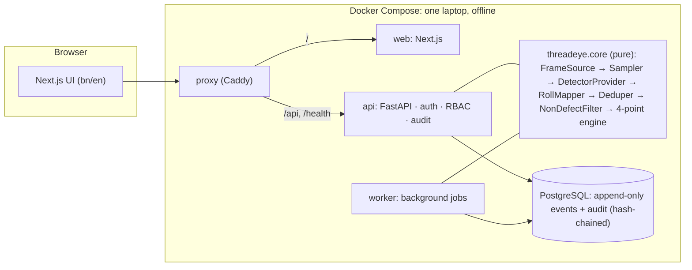

# ThreadEye AI

**A smart assistant for fabric inspection.**

ThreadEye retrofits a camera to the fabric inspection machines Bangladeshi garment factories already
own. For each roll the chain runs: frames → detector → defects in roll coordinates → non-defects
filtered → inspector confirms → 4-point verdict → photo report, claim pack, cutting instructions,
supplier scorecard.

International AI Builders Congress 2026 · *Idea to Unicorn* · IndustrySphere AI → **Quality Vision**.

> **Honesty note.** This phase uses a **simulated** detector built on our simulator's answer key.
> It is **not AI**, and every screen and report says so. No metric is shown unless it is measured.
> From M4 the team trains its own model (see [docs/PLAN.md](docs/PLAN.md) §10).

**Status: M1 (headless core + receiving) complete.** See [docs/PLAN.md](docs/PLAN.md) for the full plan.

- 4-point engine with buyer rule profiles (continuous defects, selvage exclusion, BORDERLINE, lot verdict)
- Detection pipeline: travel-based sampling, roll coordinates, de-duplication, non-defect filter,
  SIMULATED detector, evaluation metrics: `threadeye run-sample <roll dir>`
- Deliveries and rolls: register a challan, add rolls (paste from Excel), print scannable QR labels
- Append-only inspection event store with one-transaction projections

## Quick start (edge box, works offline)

Needs Docker with Compose v2. Build once while online; after that no internet is needed.

```bash
make env      # creates .env from .env.example; review the passwords
make up       # builds, starts and waits until healthy
```

Open **http://localhost:8080**. Demo accounts are one per role (`inspector`, `supervisor`, `store`,
`cutting`, `merchandiser`, `management`, `admin`) with the password set in `.env`
(`THREADEYE_DEMO_PASSWORD`).

```bash
make verify-offline   # proves the app containers have no internet access and still work
make test             # backend unit + integration tests (throwaway Postgres) + frontend checks
make lint             # ruff, mypy --strict, import contracts, eslint, tsc, i18n parity
make spike-pdf        # Bangla PDF shaping check → backend/out/spike_bangla.pdf
make help             # all commands
```

## Running against Supabase (cloud_demo profile)

The two profiles use separate config files, on purpose:

| File | Profile | Database |
|---|---|---|
| `.env` | `edge` | the Postgres container inside Docker Compose |
| `.env.cloud` | `cloud_demo` | Supabase |

`.env` cannot point at Supabase: the Compose containers sit on an internal-only network with no
route to the internet, which is exactly what `make verify-offline` proves. To run the app against
Supabase, the API and web server run on the host instead:

```bash
make cloud-env     # write .env.cloud from a pasted connection string (input stays hidden)
make cloud-setup   # create the schema and demo accounts, then verify
make cloud-run     # run the app against Supabase → http://localhost:3000
```

Tables live in the `threadeye` schema, not `public`, so Supabase's public Data API cannot reach
them. In the dashboard's table editor, switch the schema selector from `public` to `threadeye`.

## Architecture



- **Edge profile** (the product): Docker Compose on one laptop, no cloud in the core path. `db`,
  `api`, `worker` and `web` sit on an internal-only network.
- **Cloud demo profile** (the judges' link, from M6): the same code on Vercel (Next.js + FastAPI) and
  Supabase. `GET /health` runs `SELECT 1`, and a daily GitHub Action keeps Supabase awake.
- **Swappable AI:** every detector implements `DetectorProvider` (`backend/threadeye/core/providers.py`).
  Only the simulated provider may read the answer key, and import-linter enforces it.

## Repository

| Path | What |
|---|---|
| `backend/` | FastAPI API, worker, pure core (`threadeye/core`), migrations, tests |
| `frontend/` | Next.js 16 + TypeScript, next-intl (bn/en), TanStack Query, MSW mocks |
| `docs/` | Plan, API contract (`docs/api/openapi.json`), ADRs, ethics, realtime, data contracts |
| `tools/simulator/` | Roll simulator (arrives from the team; vendored as-is) |
| `data/sample_roll/` | Simulated sample roll (video committed only after the licence check) |
| `infra/` | Caddy proxy config |
| `scripts/` | Offline check, micro-fixture generator |

## Disclosure files

[PROVENANCE.md](PROVENANCE.md) (data & AI) · [TOOLING.md](TOOLING.md) (tools, IDEs, MCP) · [PROMPTS.md](PROMPTS.md) (prompt library)

## Licence

MIT, see [LICENSE](LICENSE). Third-party components keep their own licences (PROVENANCE.md).
