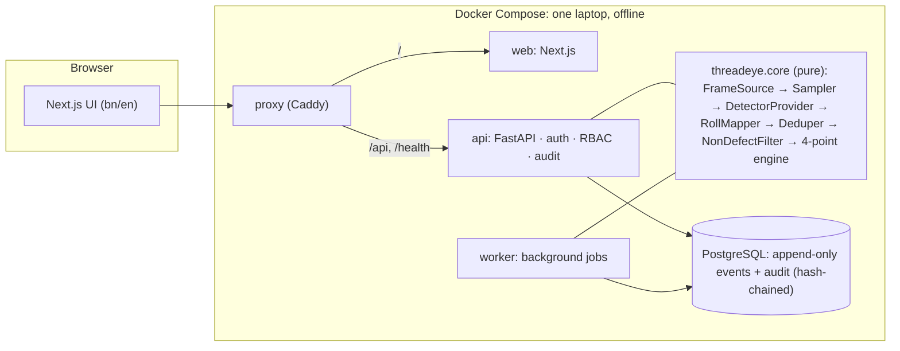

# ThreadEye AI

**কাপড় পরীক্ষার স্মার্ট সহকারী: a smart assistant for fabric inspection.**

ThreadEye retrofits a camera to the fabric inspection machines Bangladeshi garment factories already
own. For each roll the chain runs: frames → detector → defects in roll coordinates → non-defects
filtered → inspector confirms → 4-point verdict → photo report, claim pack, cutting instructions,
supplier scorecard.

International AI Builders Congress 2026 · *Idea to Unicorn* · IndustrySphere AI → **Quality Vision**.

> **Honesty note.** The camera video is **simulated**. The cloud demo uses an answer-key-based
> **simulated detector (not AI)**; `make demo` runs our **trained YOLOX-S detector** locally.
> The mode banner distinguishes these configurations. No metric is shown unless it is measured.
> [Impact evidence](docs/impact/REPORT.md) records measured detection and decision risks;
> [the pilot protocol](docs/impact/PILOT_PROTOCOL.md) explains how to measure human and business impact.

**Status:** the core flow plus operational verification, cutting approvals, dashboard KPIs, admin editing,
benchmark history and reviewed-label export are implemented locally. The repository also includes an isolated,
read-only Evidence Assistant for technical-evidence retrieval and judge review. See
[docs/MILESTONES.md](docs/MILESTONES.md) for the current scope and checks; the original schedule is in
[docs/PLAN.md](docs/PLAN.md).

- **Live inspection:** scan a roll, the simulated camera plays, defect boxes move with the fabric, a yard
  tape, speed and running/stopped state, a live points meter; the inspector confirms, rejects (with a
  reason) or changes the type of each defect in one click or key, or rejects the false alarms and
  confirms all the rest at once; a defect the detector missed is added by pausing and drawing a box
  around it on the video (exact yard, size and points, with its own evidence photo)
- **Verdict:** 4-point roll verdict (PASS / BORDERLINE / FAIL), supervisor decision with a reason, roll
  map, evidence photos, report PDF in English or Bangla, labelled SIMULATED with the detector's name
- **Power-cut safe:** every step is an append-only event; a closed browser or restarted server resumes
  from the same yard with the same result
- 4-point engine with buyer rule profiles (continuous defects, selvage exclusion, BORDERLINE, lot verdict)
- Detection pipeline: travel-based sampling, roll coordinates, de-duplication, non-defect filter,
  SIMULATED detector, evaluation metrics: `threadeye run-sample <roll dir>`
- Deliveries and rolls: register a challan, add rolls (paste from Excel), print scannable QR labels

## Quick start (edge box, works offline)

Needs Docker with Compose v2. Build once while online; after that no internet is needed.

```bash
make env      # creates .env from .env.example; review the passwords
make up       # builds, starts and waits until healthy
```

Open **http://localhost:8080**. Demo accounts are one per role (`inspector`, `supervisor`, `store`,
`cutting`, `merchandiser`, `management`, `admin`) with the password set in `.env`
(`THREADEYE_DEMO_PASSWORD`).

```bash
make verify-offline   # proves the app containers have no internet access and still work
make test             # backend unit + integration tests (throwaway Postgres) + frontend checks
make lint             # ruff, mypy --strict, import contracts, eslint, tsc, i18n parity
make spike-pdf        # Bangla PDF shaping check → backend/out/spike_bangla.pdf
make help             # all commands
```

### Inspect a roll

The live screen plays the simulated sample roll as the camera. Its video is not in git (AITEX licence
check, PLAN.md Q2): get `roll_video.mp4` from the team and put it in `data/sample_roll/`
(`sha256sum -c SHA256SUMS` there checks it). Then:

1. `store` registers a delivery and its rolls (**Deliveries & rolls**) and prints the QR labels.
2. `inspector` opens **Inspect a roll**, scans or types the roll code, picks the simulated roll and the
   detector preset (*realistic* makes mistakes to correct; *perfect* reproduces the answer key), and
   presses **Start**. Keys: Space play/pause · J/K next/previous · C confirm · X not a defect · T change type.
3. At the end of the roll: **Finish roll**, decide the pending defects (or **Confirm all pending**),
   **Compute verdict**. Pending defects block the verdict only while they could still change it: when
   the roll is PASS or FAIL whichever way they are decided, the verdict can be computed and they are
   recorded as *not reviewed*, with the points range shown on the verdict page and in the report.
4. `supervisor` records the decision on the verdict page (required for BORDERLINE). Report PDF: en/bn.

Browser test of this whole flow (needs the stack running and Google Chrome):

```bash
cd frontend && E2E_BASE_URL=http://localhost:8080 E2E_DATASET=sample_roll pnpm e2e
```

## Running against Supabase (cloud_demo profile)

The two profiles use separate config files, on purpose:

| File | Profile | Database |
|---|---|---|
| `.env` | `edge` | the Postgres container inside Docker Compose |
| `.env.cloud` | `cloud_demo` | Supabase |

`.env` cannot point at Supabase: the Compose containers sit on an internal-only network with no
route to the internet, which is exactly what `make verify-offline` proves. To run the app against
Supabase, the API and web server run on the host instead:

```bash
make cloud-env     # write .env.cloud from a pasted connection string (input stays hidden)
make cloud-setup   # create the schema and demo accounts, then verify
make cloud-run     # run the app against Supabase → http://localhost:3000
```

Log in from the terminal as any demo role (the password comes from `.env.cloud`):

```bash
./scripts/login.sh inspector            # log in and print the account's role and permissions
./scripts/login.sh admin --permissions  # also list every permission
```

The session cookie is kept in `/tmp/threadeye_cookies.txt`; reuse it with
`curl -b /tmp/threadeye_cookies.txt http://127.0.0.1:8099/api/v1/<endpoint>`.

Everything the app records lives in Supabase, including the evidence photos (table
`threadeye.blobs`), so every teammate sharing the database sees the same data. Only the simulated
roll's video is read from `data/` on each machine.

Tables live in the `threadeye` schema, not `public`, so Supabase's public Data API cannot reach
them. In the dashboard's table editor, switch the schema selector from `public` to `threadeye`.

### Cloud demo on Vercel

**https://threadeye-web.vercel.app** (frontend) and **https://threadeye-api.vercel.app** (API), both in
Tokyo (`hnd1`) next to the Supabase database. The frontend forwards `/api` to the API, so the
browser sees one origin. Log in with the demo accounts and the password from `.env.cloud`.

```bash
make cloud-upload-video        # once: the sample roll's video into Supabase (served in 3 MB pieces)
./scripts/deploy_vercel.sh     # build and deploy both projects (Vercel CLI logged in, uv, .env.cloud)
```

## Architecture



- **Edge profile** (the product): Docker Compose on one laptop, no cloud in the core path. `db`,
  `api`, `worker` and `web` sit on an internal-only network.
- **Cloud demo profile** (the judges' link, from M6): the same code on Vercel (Next.js + FastAPI) and
  Supabase. `GET /health` runs `SELECT 1`, and a daily GitHub Action keeps Supabase awake.
- **Swappable AI:** every detector implements `DetectorProvider` (`backend/threadeye/core/providers.py`).
  Only the simulated provider may read the answer key, and import-linter enforces it.

## Evidence Assistant

`threadeye-evidence-assistant/` is a separate technical-review companion. It does not import the inspection
runtime, access factory data or alter inspection decisions. Its approved corpus is fictional and isolated by
design.

It provides heading-aware ingestion, local BGE embeddings, PostgreSQL/pgvector keyword and vector retrieval
with weighted reciprocal-rank fusion, deterministic extractive answers, validated citations and explicit
abstention. One read-only MCP server exposes four tools over stdio and authenticated localhost Streamable HTTP;
a local judge UI demonstrates the same controlled evidence path.

The current verification record covers 190 passing tests, real stdio and HTTP MCP calls, and a real
Chrome/Playwright judge flow. Detailed results and limitations are in
[the companion README](threadeye-evidence-assistant/README.md),
[technical evidence](threadeye-evidence-assistant/docs/cloudcamp/TECHNICAL_EVIDENCE.md), and the
[judge demo guide](threadeye-evidence-assistant/docs/cloudcamp/JUDGE_DEMO.md).

## Repository

| Path | What |
|---|---|
| `backend/` | FastAPI API, worker, pure core (`threadeye/core`), migrations, tests |
| `frontend/` | Next.js 16 + TypeScript, next-intl (bn/en), TanStack Query, MSW mocks, Playwright golden path (`e2e/`) |
| `docs/` | Plan, API contract (`docs/api/openapi.json`), ADRs, ethics, realtime, data contracts |
| `tools/simulator/` | The team's roll simulator, vendored as-is |
| `data/sample_roll/` | Simulated sample roll (CSV/JSON in git; the video only after the licence check) |
| `infra/` | Caddy proxy config |
| `scripts/` | Offline check, micro-fixture generator |
| `threadeye-evidence-assistant/` | Isolated synthetic-evidence retrieval, read-only MCP server, local judge UI, tests and CloudCamp evidence pack |

## Disclosure files

[PROVENANCE.md](PROVENANCE.md) (data & AI) · [TOOLING.md](TOOLING.md) (tools, IDEs, MCP) · [PROMPTS.md](PROMPTS.md) (prompt library)

The Evidence Assistant's submission-facing verification is collected in the
[CloudCamp evidence pack](threadeye-evidence-assistant/docs/cloudcamp/README.md).

## Licence

MIT, see [LICENSE](LICENSE). Third-party components keep their own licences (PROVENANCE.md).

## Operations (M4–M6)

- **Daily verification:** a supervisor selects the reference roll, machine, provider and tolerances.
  Results and history are stored. RED warns on the matching machine's live inspection screen.
  Optional daily checks need the edge worker; the cloud demo uses the run button.
- **Cutting:** open a finalized inspection → Cutting sheet → supervisor approves → cutting master
  acknowledges. The PDF and strip show conservative full-width skip zones, not garment nesting.
- **Admin:** users and machines persist; buyer-rule saves create new versions. Provider defaults for
  new inspections are separate on edge and serverless. Optional sample archive is off by default.
- **Benchmark:** select held-out test datasets/providers; inspect saved results and compare two runs.
  A test manifest is required. Reviewed-label export does not automatically retrain the model.

Existing Supabase laptop installs need the additive migration once, before restarting the app:

```bash
make cloud-migrate
make demo
```

Docker applies migrations automatically. Its backend includes ONNX Runtime, vision dependencies and
ffmpeg. To use the model offline, put the model files in `data/model/`, keep the source video in
`data/linescan_roll/`, and set `THREADEYE_DETECTOR_PROVIDER=local_model` when starting Compose.

For a clean checkout without third-party video, build the images and generate a synthetic demo source
inside the offline-capable backend image (the generated data is local, not training):

```bash
make env
make build
docker run --rm --network none --user "$(id -u):$(id -g)" -v "$PWD:/work" -w /work threadeye-backend:latest \
  python tools/simulator/make_roll_video.py --source synthetic --roll-length-m 5 --seed 3 --out data/demo_roll
make up
```

Current milestone scope: [docs/MILESTONES.md](docs/MILESTONES.md). KPI definitions:
[docs/KPIS.md](docs/KPIS.md). Presentation preparation: [docs/congress/](docs/congress/).

The local demo launcher also starts the jobs worker and stops API/web/worker process groups together
on exit. The public Vercel demo does not run that persistent worker. See [docs/VALIDATION.md](docs/VALIDATION.md)
for the actual checks and the distinction between local implementation and hosted deployment.
