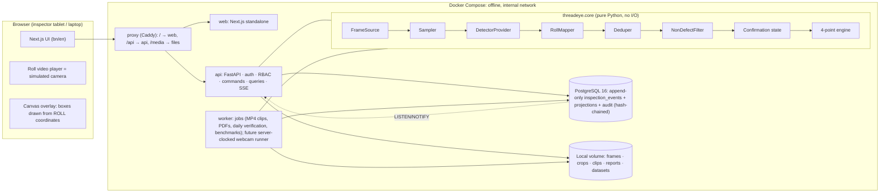
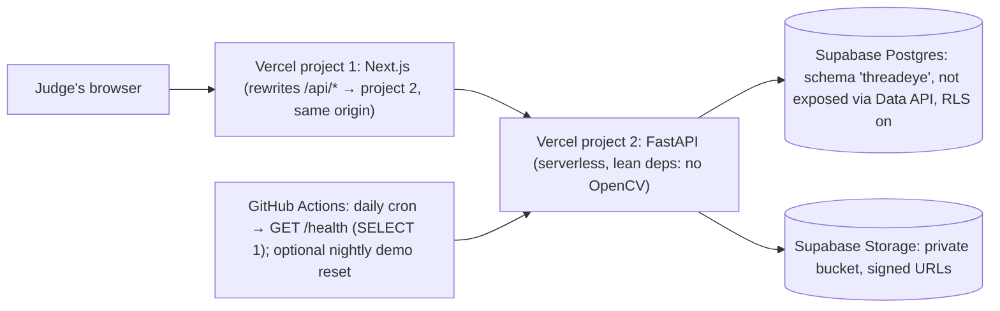
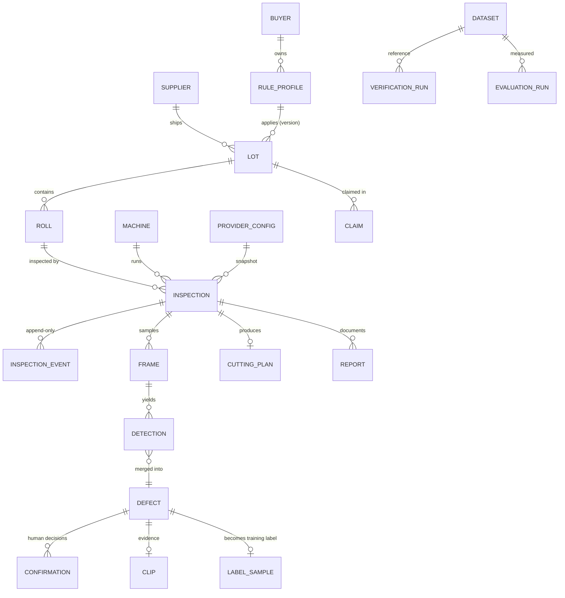

# ThreadEye AI: Build Plan (Idea to Unicorn · Quality Vision)

Plan date: Sat 3 Oct 2026. Section numbers follow Section 14 of the brief. Sources: the brief, *ThreadEye_AI_Workflow_Bangla.pdf* (39 features, ethics, timeline, risks, demo script) and *ThreadEye_AI_Problem_Solution_Planning_Bangla.pdf* (we reuse its provider abstraction, mock mode, "no false confidence" and "no false AQL claim" rules, and A/B/C/D split; its scope is superseded).

---

## 1. Product and competition goal (context)

ThreadEye AI is a retrofit camera assistant for the **fabric inspection machines garment factories already own**, used at receiving inspection in the fabric store. As each roll unwinds over the lit board, frames are sampled by **fabric travel**, sent to a swappable **detector provider**, mapped into **roll coordinates** (yard along, cm across) and **de-duplicated**. Known non-defects (stickers, loose threads, handling wrinkles, selvage pin holes, the board, the inspector's hand) are **shown but not scored**. The inspector **confirms, rejects or reclassifies every defect in one click**. A configurable **4-point engine** (buyer rule profiles, including continuous-defect and selvage rules) then produces the roll verdict and a lot verdict. From the same data the system creates the photo report, roll map, defect clips, an English **claim pack** for the mill, **cutting instructions** with usable length, and a **supplier scorecard**. That is the full systems-level chain: defect → decision → money → cutting → supplier.

**Competition goal:** score Strong/Excellent in *Idea to Unicorn*. The marks come from the parts judges can see: a clean, explainable, swappable AI pipeline with an honest **benchmark and verification story** (Technical Execution), the end-to-end chain (Innovation), measurable KPIs and **documented ethical safeguards** (Impact + Ethics), and an **offline edge-first** architecture that also has a working demo link (Scalability).

**Phase constraint:** no external AI API at any point. **M0–M3 involve no training.** A `SimulatedDetector` built on the simulator's answer key drives the whole product and is always labelled **SIMULATED**. **From M4 (1 Nov) a model-training track** produces our own detector (YOLO-family → ONNX → `LocalModelDetector`). It goes on the edge laptop by M6 and appears in the final demo video. The cloud demo stays on the labelled `SimulatedDetector`.

---

## 2. Assumptions and open questions

### Decisions taken (your answers)
| Topic | Decision |
|---|---|
| Frontend | **Next.js (App Router) + TypeScript**. Edge: `output: "standalone"` container. Cloud: native Vercel. |
| Repo | **Public GitHub, "All rights reserved" LICENSE.** Sample-roll video is committed only if the AITEX licence permits redistribution of derived images (see open Q2). |
| Demo link | **Free hosting only:** Vercel Hobby, as **two projects** (Next.js frontend + FastAPI backend), plus **Supabase free** (Postgres + Storage). `GET /health` runs `SELECT 1`. A **GitHub Actions scheduled workflow calls it daily** so the Supabase project never pauses (Nov–Dec). |
| Name | **ThreadEye AI**. Package `threadeye`, images `threadeye-*`. |
| Own model | **Model-training track (owner C) starts M4 (1 Nov).** The final product uses our own trained detector (YOLO-family → ONNX → `LocalModelDetector` on the edge laptop CPU). The cloud demo keeps `SimulatedDetector`, clearly labelled. |
| Milestone rule | **From M2 on, the core flow (load roll → live inspection → confirm → verdict → report) must pass end to end before any extra feature in that milestone starts.** |

### Simulator conventions (Q1, verified by the team in `tools/simulator/make_roll_video.py`)
- `view_region` = `{x: 0, y: 0, w: 1920, h: 1008}`. A 36 px label bar sits below it (video is 1920 × 1044).
- In `roll_y_px = roll_y_top_px[f] + y`, **`y` is measured from the top of `view_region`**.
- `ground_truth.csv` `x0_px…y1_px` are **roll coordinates**: x is relative to the fabric's left edge, y is absolute along the roll (roll px). Frame position = `(x0_px + fabric_x0_px[f], y0_px − roll_y_top_px[f])`.
- GT boxes are **already clipped to exclude the selvage band** (`selvage_band_px`). Defects fully inside the selvage are not in the answer key.
- `length_in = max(width_cm, height_cm) / 2.54` of the clipped box. Our RollMapper computes length the same way.
- **`expected_score` rules = the `simulator-parity` profile:** length bands + hole bands only; cell = `floor(center_yd)`; cap 4 per cell; **no** continuous rule; **no** selvage exclusion; **no** borderline band; per-100 = `total × 3600 / (roll_length_yd × fabric_width_in)` using `roll_meta` values; PASS if per-100 ≤ threshold. **Sample roll: 10 points, 46.45, FAIL.**

### Defaults chosen (change any by telling me)
1. **Two deployment profiles from one codebase.** `edge` (Docker Compose, offline, the *product*) and `cloud_demo` (Vercel + Supabase, the *judges' link*). The cloud is never in the core path. §3 has the capability matrix.
2. **Browser-clocked live inspection for video-file sources (both profiles).** The browser plays the roll video, which acts as the simulated camera, and drives `POST /advance`. Headless runs (verification, benchmark, tests) are server-clocked. Future webcam sources are server-clocked in the edge worker. The same `Runner.advance()` code serves all three.
3. **Realtime:** SSE on edge (Postgres LISTEN/NOTIFY). In the cloud, events come back in `/advance` responses plus 1 s polling, because Vercel functions can't hold long connections and Supabase's transaction pooler has no LISTEN. Both use one event envelope with a per-inspection `seq`.
4. **PDF:** `fpdf2` + `uharfbuzz` for Bangla shaping. It is pure Python wheels, so it runs on Vercel *and* in Docker. A spike in M0 proves Bangla shaping; the fallback is browser print-to-PDF of the report page.
5. **No OpenCV in the cloud API bundle.** It stays under the Vercel size limit. OpenCV and ffmpeg live only in the edge `[vision]` extra and the worker image.
6. **Auth:** our own (argon2id + server-side session table, httpOnly cookie), identical on both profiles. Supabase Auth and its Data API are not used.
7. **Numbers:** Latin digits for measurements and IDs by default, to match machine counters and paperwork. A per-user setting enables Bangla digits. **UI default language is Bangla for Inspector/Store/Cutting roles and English for the others**, switchable per user.
8. **Units are in field names:** `_yd` (along roll), `_cm` (across), `_in` (defect size, 4-point), `_px` (pixels). Time is UTC in the DB and Asia/Dhaka in the UI.
9. **Domain defaults that need sign-off from the textile member:** BORDERLINE band ±2.0 pts, continuous threshold 36 in, selvage exclusion 1 in, lot hold if >20 % of inspected rolls fail, cutting margin 2 in, minimum usable piece 1 yd. All are configurable and marked "default — to be validated".

### Open questions (non-blocking; owner resolves by the date shown)
| # | Question | Default until answered | Owner / by |
|---|---|---|---|
| Q1 | ~~Simulator conventions~~ | **Resolved** (see above) | — |
| Q2 | Does the AITEX Fabric Image Database licence allow redistributing derived video in a public repo, and on the public demo link? | Don't commit the video until confirmed; ship `scripts/fetch_sample_roll.sh` + SHA-256. If redistribution is forbidden, the cloud demo uses a roll rendered in the simulator's `clean` (code-drawn) mode. | D · 9 Oct |
| Q3 | When will `tools/simulator/` and `data/sample_roll/` land? | By 10 Oct; until then a synthetic micro-fixture in the same format unblocks tests | C · ASAP |
| Q4 | Final submission date (FAQ conflict) and team-lock date | Plan for **22 Dec submit** (2-day buffer before 24 Dec) | D · check dashboard 10 Oct |
| Q5 | Vercel Hobby is for non-commercial use. Is a competition demo acceptable? | Treat it as personal/non-commercial demo; fallback is a free container host | A · M2 |
| Q6 | **Training framework licence.** Ultralytics YOLO is AGPL-3.0, and Ultralytics says the licence also covers models trained with it. That conflicts with an "all rights reserved" product. | **YOLOX (Apache-2.0)**, exported to ONNX. Switch to Ultralytics only if the team accepts AGPL or buys a licence. | C · decide by 1 Nov |
| Q7 | Training compute | Free Kaggle/Colab GPU notebooks; scripts in `ml/` so runs are reproducible. Weights go in GitHub Releases, not git. | C · 1 Nov |
| Q8 | Are the sample roll's source images in the training split? | If they are, the sample roll stays the verification/demo roll, and the model benchmark uses only rolls generated from **test-split source images** | C · M4 |

---

## 3. System architecture

### 3.1 Edge profile (the product; one laptop, offline)



### 3.2 Cloud-demo profile (judges' link, free tier)



### 3.3 Capability matrix
| Capability | edge | cloud_demo |
|---|---|---|
| Live inspection of a video-file roll | ✓ browser-clocked | ✓ browser-clocked (960-px web preview served from `public/demo/`) |
| Realtime | SSE + events in `/advance` responses | events in `/advance` responses + 1 s polling |
| Sampled-frame images | browser capture (live) · server decode (headless) | browser capture (live) · headless runs store no images |
| Defect clips | time-range playback ✓ + MP4 export (ffmpeg worker) | time-range playback ✓ · stills in claim ZIP (no MP4) |
| PDF reports / claim pack / labels | ✓ fpdf2 | ✓ fpdf2 (inline) |
| Background jobs | worker + Postgres `jobs` queue | inline, within function limits |
| Daily verification | scheduled in worker | button (+ optional GH Actions call) |
| Webcam source / classical baseline (later) | ✓ | ✗ |
| Works without internet | ✓ (proved by CI on an `internal: true` network) | ✗ |

### 3.4 Live inspection sequence (both profiles)

```mermaid
sequenceDiagram
  participant V as Video (simulated camera)
  participant UI as Live screen
  participant API as FastAPI
  participant R as Runner.advance()
  participant DB as Postgres
  UI->>API: POST /inspections/{id}/start (acquire driver lease)
  API-->>UI: snapshot · sampling plan (frame list) · frame track (positions per frame)
  loop every ~300 ms while video plays
    V->>UI: requestVideoFrameCallback(frame n); if n ∈ plan → capture JPEG
    UI->>API: POST /advance {until_frame:n, captures[], after_seq}
    API->>R: process (checkpoint, n]
    R->>DB: BEGIN · events + projections + checkpoint · COMMIT
    API-->>UI: events with seq > after_seq · new checkpoint
    UI->>UI: draw boxes that move with the fabric · update yard tape and meter
  end
  UI->>API: POST /defects/{id}/confirm (Idempotency-Key)
```

### 3.5 Rationale (tied to judging criteria)
| Choice | Why | Criterion |
|---|---|---|
| `DetectorProvider` interface + provider snapshot on every inspection + provider label on every screen and report | Swap Simulated → API → own model with no other changes. Model choice is backed by the benchmark. Honest labelling. | Tech Exec (model selection, explainability), Ethics (transparency) |
| Pure `threadeye.core` (sampler, mapper, deduper, filter, 4-point engine) with no I/O | Unit-testable, explainable step by step, runs identically in API, worker, CLI and cloud | Tech Exec (input → processing → output clarity, reliability) |
| Append-only `inspection_events` + projections in **one transaction** + checkpoint + idempotency keys | Power cut loses nothing. Resume is idempotent. Projections can be rebuilt (proved by test). | Tech Exec (robustness), Impact (factory reality) |
| Docker Compose, offline, no CDN, self-hosted fonts | Edge-first: images never leave the factory (buyer design confidentiality) | Scalability (infrastructure feasibility), Ethics (privacy) |
| Benchmark + daily verification pages that reuse `evaluate.py` metrics | Data-driven claims, a measurement culture, and a camera-health story | Tech Exec, Presentation (data-driven), Impact (KPIs) |
| Full chain: claim pack + cutting + scorecard | "Not just detection, a decision" (Workflow PDF §7) | Innovation (systems-level), Business (money saved) |
| Rule profiles versioned per buyer; 4-point is configurable | Same product works for any buyer or country that uses 4-point | Business + Global readiness |
| Same code on free cloud (Vercel + Supabase) | Working demo link at zero cost, while the core stays edge | Scalability (cloud readiness), Presentation |
| Next.js | Team familiarity (your choice). We use client components plus TanStack Query; SSR isn't needed. | Delivery risk |

---

## 4. Data model

PostgreSQL 16; UUIDv7 primary keys (sync-safe for future multi-box); `timestamptz` UTC; JSONB validated by Pydantic. **Events are the source of truth for inspections; marked (P) tables are projections**, written in the same transaction and rebuildable with `threadeye rebuild-projections`.



| Entity | Key fields | Notes |
|---|---|---|
| **users** | username, display_name, password_hash (argon2id), role, locale, digit_style, active | one role per user |
| **sessions** | user_id, token_hash, expires_at, revoked_at, ip, user_agent | revocable; 12 h (one shift) |
| **suppliers** (mills) | name, country, is_sample_data | |
| **buyers** | name, is_sample_data | |
| **rule_profiles** | buyer_id, name, **version**, status (draft/active/retired), rules JSONB, rules_hash | **immutable once active**; editing creates a new version; inspections pin a version |
| **defect_classes** | id, label_en, label_bn, kind (defect/nondefect), is_hole, continuous_default, colour | seeded from `taxonomy.yaml`; taxonomy hash pinned per inspection |
| **machines** | code, name, calibration JSONB, default_source | |
| **provider_configs** | name, provider_id (simulated/api/local_model/classical), version, params JSONB, params_hash, is_simulated, status (available/stub/disabled), is_default | |
| **lots** (delivery/challan) | challan_no, supplier_id, buyer_id, order_ref, fabric_type, colour, received_at, declared_rolls, declared_total_yd, rule_profile_id, sampling_pct, status, lot_verdict, decided_by, is_sample_data | |
| **rolls** | lot_id, **roll_code** (unique, QR payload), mill_roll_no, dye_lot, declared_length_yd, declared_width_in, gsm, status (registered/in_inspection/inspected/on_hold/released/returned), selected_for_inspection, label_printed_at | |
| **inspections** | roll_id, machine_id, inspector_id, rule_profile_id, provider_config_id + **provider_snapshot**, source_descriptor (dataset id + file SHA-256s), taxonomy_hash, mode (production/demo/verification/evaluation), **is_simulated**, clock (browser/server/headless), status (created/running/paused/interrupted/completed/aborted), **checkpoint_frame**, checkpoint_yd, last_seq, driver_lease (session, expires_at), coverage_pct, measured_length_yd, measured_width_in, width_source, system_verdict, points_total, points_per_100, final_verdict, decision_by/reason/at | one active inspection per roll |
| **inspection_events** | id bigserial, inspection_id, **seq** (unique per inspection), type, occurred_at, actor_kind (user/engine/system), actor_user_id, **idempotency_key** (unique), payload JSONB, schema_version | DB trigger blocks UPDATE/DELETE |
| **frames** (P) | inspection_id, frame_index (unique per inspection), time_s, roll_y_top_px, top_yd, bottom_yd, fabric_x0_px, speed_m_min, state, hand_visible, image_key, image_sha256, image_scale, sample_reason | |
| **detections** (P) | frame_id, provider_id/version, cls, confidence (nullable), explanation, bbox_px, roll box (along_start_cm, along_end_cm, across_start_cm, across_end_cm), truncated (top/bottom/none), defect_id, raw JSONB | raw provider output kept for audit and debugging |
| **defects** (P) | inspection_id, defect_no (D-01…), origin (detector/manual), predicted_cls, current_cls, kind (defect/nondefect), nondefect_category, status (pending/confirmed/rejected), start_yd, end_yd, center_yd, across_start_cm, across_end_cm, length_in, length_source (pixels/inspector), is_continuous, sightings, best_frame_id, crop_key, points, points_explanation JSONB, excluded_reason | the de-duplicated physical defect |
| **confirmations** (P) | defect_id, user_id, action (confirm/reject/reclassify/promote_nondefect/edit_length/add_manual), from_cls, to_cls, reason_category, channel (click/keyboard/voice), at, event_seq | also feeds labels |
| **stops** (P) | inspection_id, start_frame, end_frame, start_yd, duration_s, reason (defect_check/inspector_pause/unknown), defect_id | |
| **measurements** (P) | inspection_id, kind (width/length), position_yd, value, unit, entered_by | manual width until edge-width detection (NEXT) |
| **clips** | defect_id, start_frame, end_frame, start_s, end_s, file_key (nullable), sha256, status | time-range clip always; MP4 file on edge |
| **reports** | kind (roll/lot/claim/cutting/verification/evaluation/label), subject, language, file_key, sha256, **simulated**, **provider_label**, template_version, generated_by/at | |
| **claims** | lot_id, supplier_id, roll_ids, status (draft/exported/sent_manually/acknowledged/settled/rejected), amount, currency, letter_lang, report_id, evidence_zip_key, manifest_sha256 | we never send email; export only |
| **cutting_plans** | inspection_id, segments JSONB [{from_yd,to_yd,action,reason,defect_ids}], usable_length_yd, waste_yd, policy JSONB, status (draft/approved/acknowledged) | |
| **source_images** | origin (AITEX…), file, sha256, **split** (train/val/test), licence | split is assigned **by source image**, so nothing leaks between train and test |
| **datasets** | name, kind (simulated_roll/reference_roll/real_capture/yolo_export), **split** (train/val/test/reference, derived: a roll is `test` only if all its source images are test), source_image_ids, storage_prefix, meta (roll_meta), file hashes, fabric_attrs (colour/pattern), licence, provenance, is_simulated | answer key files are readable only by oracle/eval modules |
| **verification_runs** | machine_id, dataset_id, provider_snapshot, tolerance JSONB, inspection_id, metrics, result (green/red/error), reasons, triggered_by | |
| **evaluation_runs** | dataset_ids, split, provider_snapshot, seed, code_version (git SHA), metrics, per_roll, status | |
| **label_samples** | defect_id, frame_id, bbox_px, final_cls, source (inspector/supervisor/answer_key), split, usable_for_training | corrections become labelled data |
| **model_versions** (empty now) | provider_id, artifact_key, sha256, trained_on_dataset_ids, test_metrics | lets the train/test guard exist from day one |
| **audit_log** | at, actor_user_id, actor_role, action, entity_type, entity_id, before, after, ip, request_id, prev_hash, **hash** | append-only trigger + SHA-256 chain; every user command writes one row in the same txn |
| **jobs** | kind, payload, status, attempts, run_after, locked_by/at, last_error, result | edge queue (`FOR UPDATE SKIP LOCKED`) |
| **settings** | key, value JSONB | factory name, digit style, retention, demo flags |

---

## 5. Backend API (`/api/v1`, JSON, OpenAPI is the contract)

The contract is FastAPI → `docs/api/openapi.json`, committed. CI fails on drift. The frontend generates types with `openapi-typescript` + `openapi-fetch`, so B can build against MSW mocks from week 1. Every mutating call accepts an `Idempotency-Key` header. Every mutating call writes an audit row. Role checks happen server-side through `Depends(require(Perm.X))`.

| Area | Endpoints | Roles (beyond Admin) |
|---|---|---|
| Health | `GET /health`, served at the **API root, outside `/api/v1`** (no auth; runs `SELECT 1`; returns `{status, db, profile, version, simulated_mode}`; 503 on DB failure). Used by Docker healthcheck and the GH Actions keep-alive. | public |
| Auth | `POST /auth/login` · `POST /auth/logout` · `GET /auth/me` · `PATCH /auth/me` (locale, digits) | all |
| Admin | `GET/POST/PATCH /users` · `GET/POST/PATCH /machines` · `GET/PATCH /settings` · `POST /admin/demo/reset` (token; cloud only) | Admin |
| Master data | `GET/POST/PATCH /suppliers`, `/buyers` | Store, Merch |
| Rule profiles | `GET /rule-profiles?buyer_id` · `POST /rule-profiles` (new version) · `POST /rule-profiles/{id}/activate` · `POST /rule-profiles/preview` (score a what-if defect list) | QC Sup |
| Lots & rolls | `GET/POST /lots` · `GET/PATCH /lots/{id}` · `GET /lots/{id}/sampling-suggestion` · `GET /lots/{id}/verdict` · `POST /lots/{id}/decision` · `POST /lots/{id}/rolls` (bulk) · `GET /rolls?…` · `GET /rolls/{id}` · `GET /rolls/by-code/{code}` (QR scan) · `GET /rolls/{id}/label.pdf` · `POST /lots/{id}/labels.pdf` | Store (write); others read |
| Inspection lifecycle | `POST /inspections` {roll_code, machine_id, source{dataset_id}, provider_config_id?} · `GET /inspections/{id}` (snapshot incl. last_seq, checkpoint) · `POST /inspections/{id}/start\|pause\|resume\|complete\|abort` · `GET /inspections/{id}/plan` (sampling plan) · `GET /inspections/{id}/track` (per-frame positions for overlay) · `POST /inspections/{id}/advance` {until_frame, captures[], after_seq} → {events[], checkpoint_frame, last_seq} · `POST /inspections/{id}/run-headless` (worker/inline) | Inspector, QC Sup |
| Events | `GET /inspections/{id}/events?after_seq=&limit=` · `GET /inspections/{id}/stream` (SSE, edge) | readers of the roll |
| Defects | `GET /inspections/{id}/defects` · `GET /defects/{id}` (sightings, frames, clip, points explanation) · `POST /defects/{id}/confirm` · `/reject` {reason_category} · `/reclassify` {to_cls} · `/promote` (non-defect → defect) · `/length` {length_in} · `POST /inspections/{id}/defects` (add missed defect at current yard) | Inspector, QC Sup |
| Measurements & verdict | `POST /inspections/{id}/measurements` · `GET /inspections/{id}/score` (full explanation) · `POST /inspections/{id}/finalize` (blocked while pending) · `POST /inspections/{id}/decision` {final_verdict, reason} (BORDERLINE / override) | Inspector; decision: QC Sup |
| Evidence | `GET /inspections/{id}/roll-map` · `GET /frames/{id}/image` · `GET /defects/{id}/crop` · `GET /defects/{id}/clip` (time range + MP4 when present) · `POST /reports` {kind, subject_id, lang} · `GET /reports/{id}` · `GET /reports/{id}/download` | QC Sup, Mgmt, Merch, Store (read) |
| Claims | `POST /claims` · `GET/PATCH /claims/{id}` · `POST /claims/{id}/render` · `GET /claims/{id}/pack.zip` | Merch (write), QC Sup |
| Cutting | `GET /inspections/{id}/cutting-plan` · `POST …/cutting-plan/approve` · `POST …/cutting-plan/acknowledge` · `GET …/cutting-plan.pdf` | QC Sup approve; Cutting Master ack |
| Suppliers | `GET /suppliers/{id}/scorecard?from&to` · `GET /suppliers/scorecards` | Merch, Mgmt, QC Sup |
| Dashboard | `GET /dashboard/summary?date&machine` · `GET /dashboard/trends?from&to&group_by` · `GET /dashboard/kpis` | Mgmt, QC Sup (Inspector: own-shift summary only) |
| Verification | `POST /verification-runs` · `GET /verification-runs?date` · `GET /verification-runs/{id}` · `GET /verification/today` | QC Sup run; all read status |
| Benchmark | `GET /datasets` · `POST /evaluation-runs` · `GET /evaluation-runs` · `GET /evaluation-runs/{id}` · `GET /evaluation-runs/compare?ids=` | QC Sup, Mgmt, Admin |
| Providers | `GET /providers` (registered kinds + availability) · `GET/POST /provider-configs` · `POST /provider-configs/{id}/activate` | Admin |
| Labels | `GET /labels?split` · `POST /labels/export` (COCO JSON zip) | Admin |
| Audit | `GET /audit?entity&actor&from&to` · `GET /audit/verify` (hash chain check) | Admin, Mgmt |
| System | `GET /system/status` (db, worker heartbeat, disk, active provider, mode, profile) | all |

### 5.1 Realtime channel contract
- **Envelope (durable events, stored with `seq`):**
  ```json
  {"v":1,"inspection_id":"0192…","seq":1042,"type":"defect.upserted",
   "at":"2026-10-20T04:15:22.123Z","actor":{"kind":"engine"},
   "simulated":true,"provider":"simulated@1.0.0","payload":{…}}
  ```
- **SSE (edge):** `GET /inspections/{id}/stream`, which resumes from `Last-Event-ID` (= `seq`) or `?after_seq=`. Server replays from the DB, then streams live events (LISTEN `inspection_events`). Each event is sent as `id: <seq>` / `event: <type>` / `data: <envelope>`. Heartbeat every 15 s as an SSE comment. Headers: `Cache-Control: no-transform`, `X-Accel-Buffering: no`.
- **Polling (cloud, and fallback anywhere):** `GET /events?after_seq=N` every 1 s. `/advance` responses also carry new events. The client applies events **idempotently by seq**, so mixing transports is safe.
- **Client bootstrap:** `GET /inspections/{id}` (snapshot + `last_seq`), then subscribe with `after_seq = last_seq`.
- **Ephemeral messages** (not stored, no `id`): `machine.tick` {frame, top_yd, bottom_yd, speed_m_min, state} ≤5 Hz. Only server-clocked sources (future webcam) need these. File sources compute ticks client-side from `/track`.

| Durable event type | Payload (key fields) |
|---|---|
| `session.started` / `paused` / `resumed` / `interrupted` / `completed` / `aborted` | status, checkpoint_frame, checkpoint_yd, reason |
| `machine.stopped` / `machine.started` | frame, at_yd |
| `frame.sampled` | frame_id, frame_index, top_yd, bottom_yd, hand_visible, image_url?, sample_reason |
| `detection.batch` | frame_id, provider, latency_ms, detections[{cls, confidence\|null, explanation, bbox_px, roll_box, truncated}] |
| `defect.upserted` | defect (full projection), change: created/merged/filtered/confirmed/rejected/reclassified/length_edited/manual |
| `score.updated` | provisional & confirmed {points_total, per_100, cells[]}, threshold, band, points_budget, provisional_verdict, yards_inspected, coverage_pct |
| `measurement.recorded` | kind, position_yd, value |
| `verdict.computed` / `verdict.decided` | system_verdict, totals, explanation / final_verdict, by, reason |
| `clip.ready` | defect_id, start_s, end_s, url? |
| `alert` | kind (pending_defects, hand_in_view, verification_red, provider_unavailable), message_key |

---

## 6. Detection pipeline

### 6.1 Steps
1. **FrameSource** provides `FramePosition` for every frame: from `frames.csv` for file sources, or from a PositionProvider (encoder or counter-OCR, later) for webcams. It also provides images on demand.
2. **Sampler** (`core/sampling.py`) works by **fabric travel**. `view_len_px = view_region.h`; `step_px = view_len_px × (1 − overlap)` (default overlap 0.15). It takes a frame when `roll_y_top_px − last_sampled ≥ step_px`, never while `state == stopped`, and emits a final frame at roll end. **Hand avoidance:** if the candidate has `hand_visible`, it looks ahead to the first clean frame, but only while travel stays ≤ `view_len_px × (1 − min_overlap)` (min_overlap 0.05). Otherwise it takes the hand frame and flags it. **Invariant:** the union of sampled windows covers the whole roll with no gaps (tested). The same class runs in streaming mode (webcam) or precomputes a **SamplingPlan** for file sources (the plan is deterministic from `frames.csv` + config and is sent to the browser for frame capture).
3. **Image acquisition** happens only for sampled frames. Live file inspections use a browser capture (`requestVideoFrameCallback` → canvas crop to `view_region` → JPEG upload with `/advance`). Headless runs on edge use server decode (OpenCV sequential read). `image_scale` records capture px per source px. If a capture is missing, providers that need images block (the response tells the client to seek back). Providers that don't (Simulated) proceed and mark `image_missing`.
4. **DetectorProvider.detect(frame)** returns `Detection`s in view pixels.
5. **RollMapper** (`core/geometry.py`) applies `bbox / image_scale`, then `roll_y_px = roll_y_top_px[f] + y`, `yd = roll_y_px / px_per_cm / 91.44`, `across_cm = (x − fabric_x0_px[f]) / px_per_cm`. It flags `truncated` when the box is within 3 px of the view's top or bottom edge. The inverse mapping (roll → current frame) lets the overlay keep boxes **attached to the moving fabric** between detections.
6. **Deduper** (`core/dedupe.py`, incremental, per inspection) only compares against defects within ±1 view length. It merges when roll-box IoU > 0.3 **or** centres ≤ 3 cm apart (both configurable). Box = **mean of non-truncated sightings**. If every sighting is truncated (a running defect longer than the view), box = **union**. Adjacent truncated pieces of the same class/track also union. Class = majority vote, ties broken by confidence, then first seen. Records `sightings` and `best_frame_id` (most central, non-hand).
7. **NonDefectFilter** (`core/nondefect.py`) is an ordered rule chain. Each rule returns `(category, explanation)`:
   (a) the provider's class is a non-defect class (sticker, loose_thread, wrinkle, pin_hole, hand, board);
   (b) the box lies outside the fabric edges → `board`;
   (c) a small hole-class box (< 0.3 in) inside `selvage_band` → `pin_hole`;
   (d) seen only in hand-visible frames → **flag `uncertain_hand`** (still a defect, inspector decides).
   Non-defects are **drawn grey-dashed, never scored, counted per category**, and can be promoted to a defect by the inspector.
8. **Confirmation:** new defects are `pending`. One click confirms, rejects (with a reason category that mirrors the non-defect list) or reclassifies. The inspector can edit the length and can **add a missed defect** at the current yard. Every action is an event, a `confirmations` row and a `label_sample`.
9. **Scoring** (§7) re-scores the whole roll after every change (cheap). **Provisional** = pending + confirmed defects. **Final** = confirmed only. Finalize is blocked while anything is pending; a supervisor may bulk-resolve with a reason.

Each `/advance` call processes its frame range in **one transaction**: frame rows, detections, defect upserts, score, events and the checkpoint. Idempotency keys are deterministic (`{inspection}:{frame}:{stage}`), so re-processing after a crash is a no-op.

### 6.2 Exact interfaces (`backend/threadeye/core/frames.py`, `core/providers.py`)

```python
Rect = tuple[int, int, int, int]                      # x, y, w, h (raw video px)
BBox = tuple[float, float, float, float]              # x0, y0, x1, y1 (view px of THIS frame)

@dataclass(frozen=True)
class Calibration:
    px_per_cm: float
    view_region: Rect                                  # crop that excludes the info bar
    fabric_width_cm: float
    selvage_band_px: float | None

@dataclass(frozen=True)
class FramePosition:
    frame: int
    time_s: float
    roll_y_top_px: float                               # roll-space y of the view's top row
    top_yd: float
    bottom_yd: float
    speed_m_min: float | None
    state: Literal["running", "stopped", "unknown"]
    fabric_x0_px: float | None                         # left fabric edge, view px
    hand_visible: bool | None

@dataclass(frozen=True)
class FrameImage:                                      # lazy, no numpy needed in core
    jpeg: bytes
    width: int
    height: int
    scale: float                                       # image px per source view px
    def as_array(self) -> "np.ndarray": ...            # imports numpy/cv2 lazily (edge only)

@dataclass(frozen=True)
class FramePacket:
    pos: FramePosition
    image: FrameImage | None

@dataclass(frozen=True)
class SourceInfo:
    kind: Literal["video_file", "webcam", "browser_capture"]
    is_simulated: bool
    fps: float
    frame_count: int | None                            # None for live sources
    calibration: Calibration
    roll_length_yd: float | None
    descriptor: dict                                   # dataset id + file sha256s (pinned on inspection)

class FrameSource(ABC):
    @abstractmethod
    def open(self) -> SourceInfo: ...
    @abstractmethod
    def track(self) -> Sequence[FramePosition] | None: ...      # full track for file sources, None for live
    @abstractmethod
    def read(self, start: int, stop: int | None,
             want_image: Callable[[FramePosition], bool]) -> Iterator[FramePacket]: ...
    def frame_for_yard(self, yd: float) -> int:                  # resume support
        raise NotSeekable
    @abstractmethod
    def close(self) -> None: ...

# Implementations: VideoFileSource (frames.csv + OpenCV decode, edge),
# CaptureFrameSource (frames.csv track + images uploaded by the browser, both profiles),
# WebcamSource (STUB: camera index + PositionProvider; NotImplementedError + TODO).
```

```python
@dataclass(frozen=True)
class Detection:
    bbox_px: BBox
    cls: str                                           # taxonomy id; defect OR non-defect class
    confidence: float | None                           # None unless provider is calibrated
    explanation: str                                   # required, human-readable
    attributes: Mapping[str, Any] = field(default_factory=dict)

@dataclass(frozen=True)
class ProviderInfo:
    provider_id: str                                   # "simulated" | "api" | "local_model" | "classical"
    version: str
    display_name: str                                  # shown on every screen and report
    kind: Literal["simulated", "api", "local_model", "classical"]
    is_simulated: bool                                 # drives the SIMULATED DETECTIONS banner
    requires_image: bool
    calibrated_confidence: bool
    bbox_quality: Literal["precise", "approximate"]
    classes: tuple[str, ...]
    config_hash: str

@dataclass(frozen=True)
class DetectionResult:
    frame: int
    detections: list[Detection]
    latency_ms: float
    provider: ProviderInfo
    error: str | None = None                           # provider failure is reported, never hidden

class DetectorProvider(ABC):
    def __init__(self, config: Mapping[str, Any], ctx: ProviderContext): ...
    @property
    @abstractmethod
    def info(self) -> ProviderInfo: ...
    def prepare(self, source: SourceInfo) -> None: ...          # load model / oracle, warm up
    @abstractmethod
    def detect(self, frame: FramePacket) -> DetectionResult: ...
    def close(self) -> None: ...

# ProviderContext: storage, logger, seed. ONLY providers of kind "simulated" receive
# `answer_key` (ground_truth + nuisance). An import-linter contract allows only
# providers.simulated and services.{verification,benchmark} to import
# threadeye.datasets.answer_key; core.evaluation receives ground truth as plain arguments.
# Registry: provider_id -> class, selected by provider_configs (env default DETECTOR_PROVIDER=simulated).
```

### 6.3 SimulatedDetector (build now)
- **Visibility:** a GT defect is visible if its roll box intersects the frame window `[roll_y_top_px, roll_y_top_px + 1008]` with ≥ `min_visible_fraction` (0.5). It is mapped into the frame as `(x0_px + fabric_x0_px[f], y0_px − roll_y_top_px[f])` → `(x1_px + fabric_x0_px[f], y1_px − roll_y_top_px[f])` and clipped to the view, with truncation flagged. A nuisance is visible if `frame ≥ appears_frame` and it lies in the window; its box is centre ± extent/2.
- **Imperfection params (all seeded):**

  | Param | Default (realistic preset) |
  |---|---|
  | `miss_rate` (per defect or per sighting) | 0.10 per defect |
  | `jitter_px` (σ on box edges) | 4 |
  | `confusion` (class matrix or global rate) | 0.10 |
  | `nuisance_flag_rate` (nuisance reported as a defect class) | 0.30 |
  | `nuisance_recognized_rate` (reported as its non-defect class) | 0.50 |
  | `selvage_pinhole_fp_rate` | 0.05 |
  | `random_fp_per_frame` (unexplained) | 0.0 |

  The **`perfect` preset sets all of these to 0** and is used by the integration test.
- **Determinism:** each random draw uses `rng(hash(seed, object_id, frame))`, so results are **independent of call order** and identical after resume.
- **Honesty:** `confidence = None`. The explanation reads e.g. *"SIMULATED: answer-key defect GT-03 (hole), jitter applied, no class confusion"*. `is_simulated = True`.

---

## 7. 4-point and verdict engine (`core/scoring/`, pure functions)

`score_roll(defects, geometry, profile) -> ScoreResult` returns per-defect points with reasons, per-yard cells, capped points, total, per-100, verdict and a human-readable explanation trail. `lot_verdict(rolls, profile) -> LotResult` handles lots.

### 7.1 Rule profile schema (defaults; every number configurable per buyer version)
```yaml
length_bands_in: [[3, 1], [6, 2], [9, 3], [.inf, 4]]   # ≤3→1, ≤6→2, ≤9→3, >9→4 (largest dimension)
hole_bands_in:   [[1, 2], [.inf, 4]]                    # ≤1→2, >1→4
length_rounding_in: 0.01                                # absorbs float noise before banding
max_points_per_yard: 4
continuous: {min_along_in: 36, points_per_yard: 4, classes_always: [shade_bar]}
selvage_exclusion: {enabled: true, distance_in: 1.0, rule: entirely_within}   # or center_within
threshold_per_100: 40
borderline: {below: 2.0, above: 2.0}                   # set both 0 to disable
per100_rounding: 2
width_basis: declared                                  # declared | measured | cuttable
length_basis: inspected                                # inspected | declared (parity profile uses declared = roll_meta)
length_check: {tolerance_pct: 0.5, tolerance_yd: 0.25}
width_check: {tolerance_in: 0.5}
lot: {min_sample_pct: 10, min_sample_rolls: 1, hold_if_fail_pct_over: 20,
      reject_if_fail_pct_over: 50, borderline_counts_as: fail}
cutting: {min_points_to_cut: 2, margin_in: 2, min_piece_yd: 1.0}
report_title: "4-point inspection report"              # never "ASTM/AQL compliant"
```

### 7.2 Algorithm
1. **Scoring set:** provisional = pending + confirmed defects of kind `defect`. Final = confirmed only. Rejected items and non-defects score 0 and are counted under "ignored".
2. **Selvage exclusion** (if enabled): `band_cm = distance_in × 2.54`. The defect is excluded when `across_end_cm ≤ band_cm` or `across_start_cm ≥ fabric_width_cm − band_cm` (*entirely within*). An excluded defect gets 0 points with the reason "within 1 in of selvage (buyer rule)".
3. **Continuous:** `along_in = (end_yd − start_yd) × 36`. If `along_in ≥ min_along_in` or the class is in `classes_always`, the defect is continuous. **Cells = `range(floor(start_yd), ceil(end_yd))`** (half-open yard cells `[k, k+1)`; zero length → `[floor(start_yd)]`), and each cell gets `points_per_yard`.
4. **Banding (non-continuous):** `L = round(largest_dimension_in, 0.01)`. Holes use `hole_bands_in`, everything else uses `length_bands_in`; comparisons are `≤` upper bound. The defect is assigned to cell `floor(center_yd)`, clamped to the last cell.
5. **Per-yard cap:** `cell_points = min(max_points_per_yard, Σ points in cell)`. The excess is shown as "capped".
6. **Total** = Σ cell_points. **Per-100** = `total × 3600 / (yards_inspected × width_in)`. Width comes from `width_basis`; if measured width is missing it falls back to declared and is flagged. Yards inspected and width must both be > 0.
7. **Verdict** on `p = round(per100, 2)`, threshold T, band b₋/b₊:
   **PASS** if `p ≤ T − b₋` · **BORDERLINE** if `T − b₋ < p ≤ T + b₊` · **FAIL** if `p > T + b₊`.
   With b₋ = b₊ = 0 this reduces to the standard rule (≤ T PASS, > T FAIL).
   BORDERLINE requires a supervisor decision: ACCEPT / ACCEPT_WITH_CLAIM / REJECT, with a reason. Any override of PASS/FAIL also needs a reason and is audited.
8. **Live meter:** shows provisional points vs the **points budget** = `T × declared_length_yd × width_in / 3600`, plus running per-100. The verdict colour shows only after ≥ 5 yd, because early per-100 values are volatile.
9. **Length/width check:** shortage = declared − measured. Flag when `shortage > max(tolerance_yd, tolerance_pct × declared)`. Narrow width is flagged when `measured < declared − tolerance_in`. Shortage flows into the claim pack.
10. **Lot verdict:**
    - **PENDING_SAMPLE** until inspected ≥ max(min_sample_rolls, ceil(min_sample_pct × rolls)).
    - Then `fail_pct = failed / inspected`, with BORDERLINE counted per `borderline_counts_as` until decided.
    - fail_pct ≤ hold → **ACCEPT** (failed rolls go to claim/return).
    - fail_pct > hold → **HOLD_INSPECT_ALL**.
    - After 100 % inspection: fail_pct > reject → **REJECT**, else **ACCEPT_WITH_REJECTS**.
    - The supervisor confirms the lot decision.
11. **Partial roll** (aborted): no system verdict, status INCOMPLETE. A supervisor can finalise "partial: 62/100 yd" with a reason.

### 7.3 Worked examples
**A. Mixed roll:** 60 in wide, 120 yd inspected, T = 40, band ±2, selvage exclusion on.

| Defect | Size / position | Rule | Points | Cell |
|---|---|---|---|---|
| d1 hole | 0.5 in @ 10.4 yd | hole ≤1 in | 2 | 10 |
| d2 stain | 4 in @ 10.7 | 3–6 in | 2 | 10 |
| d3 slub | 2 in @ 10.9 | ≤3 in | 1 | 10 → 2+2+1 = 5 → **capped 4** |
| d4 crease mark | 7 in @ 55.2 | 6–9 in | 3 | 55 |
| d5 hole | 1.5 in @ 80.1 | hole >1 in | 4 | 80 |
| d6 shade bar | 72.5 → 75.2 yd (continuous) | 4/yd × cells 72, 73, 74, 75 | 16 | 72–75 |
| d7 knot | 0.8 in, 0.5 in from selvage | excluded (buyer rule) | 0 | — |

Total = 4 + 3 + 4 + 16 = **27**. Per-100 = 27 × 3600 / (120 × 60) = 97 200 / 7 200 = **13.5 → PASS**.

**B. Cap with continuous:** if d4 (3 pts) sat in yard 73 instead of 55, cell 73 is already 4 (continuous), so it stays 4 and the total becomes 24.

**C. Borderline:** 60 in, 50 yd, 34 pts → 34 × 3600 / 3000 = **40.8**. With band ±2 → BORDERLINE (38 < 40.8 ≤ 42). With band 0 → FAIL.

**D.** 33 pts → 39.6. With band ±2 → BORDERLINE. With band 0 → PASS.

**E. Sample roll, simulator-parity profile** (length + hole bands, cell = floor(center_yd), cap 4, no continuous, no selvage, no band, `roll_meta` length × width): **10 points → 46.45 → FAIL** (> 40). It is also FAIL under the default profile (46.45 > 42). The integration test asserts `expected_score` from `roll_meta.json` exactly: points equal, per-100 equal after rounding to 2 dp, verdict equal.

**F. Lot:** 30 rolls, 10 % sample = 3 rolls, 1 fails = 33 % > 20 % → HOLD_INSPECT_ALL. After all 30, 4 fail = 13 % ≤ 50 % → ACCEPT_WITH_REJECTS, and those 4 rolls go to the claim pack.

### 7.4 Edge cases (each one is a unit test)
- Bands exactly at 3.00 / 6.00 / 9.00 in, and holes at 1.00 vs 1.01 in.
- 2.996 in rounds to 3.00 → 1 pt.
- `center_yd = 7.000` → cell 7.
- Defect straddling a yard boundary but shorter than 36 in → one cell, chosen by centre.
- Continuous 40.2 → 43.0 → cells 40, 41, 42 (cell 43 isn't touched).
- Continuous defect running past the roll end → clamped.
- Merged double sightings score once.
- Selvage: entirely in band → excluded. Partly in band → counted. Right edge. Exclusion disabled.
- Reclassify hole → stain after confirmation → re-banded.
- Zero defects → 0 → PASS.
- Per-100 of 40.004 rounds to 40.00 → PASS (band 0).
- Inspected length 0 → error.
- Measured width missing → declared width used, flagged.
- Profile version pinned; a later profile edit doesn't change old reports (what-if preview is read-only).
- Manual "missed defect" with an inspector-entered length.

---

## 8. Screens (Next.js App Router, role-aware navigation)

Common chrome on every screen: language toggle (Bangla / English), user/role, **mode banner** ("SIMULATION MODE — simulated video and detections, not real AI") whenever the source or provider is simulated, a **provider badge** ("Detector: Simulated v1.0"), and a **"SAMPLE DATA"** badge on any sample entity or aggregate. The inspector screens use large touch targets and keyboard shortcuts.

| # | Screen (route) | Purpose | Main components |
|---|---|---|---|
| 1 | Login `/login` | Sign in | form, language toggle |
| 2 | Dashboard `/` | Today at a glance | KPI tiles (rolls inspected, pass/fail/borderline, avg per-100, false-alarm rate, coverage %), today's verification tile (green/red/amber), active inspections, top defect types, by machine/mill (Recharts) |
| 3 | Lots `/lots`, Lot detail `/lots/[id]` | Register a delivery; see the lot verdict | challan form, bulk roll entry (paste/CSV), sampling suggestion (profile % plus the mill's recent fail rate as context; adaptive "smart sampling" is NEXT), lot verdict card + decision, roll table |
| 4 | Roll labels `/lots/[id]/labels` | Print QR labels | label preview (100×50 mm + A4 sheet), PDF |
| 5 | Load roll `/inspect` | Scan or enter the roll code; buyer profile applied automatically; choose machine/source | QR input (USB scanner as keyboard; camera scan optional), profile summary, start button |
| 6 | **Live inspection** `/inspect/[id]` | The core screen | video shown uncropped, so its "SIMULATED FEED" bar stays visible (overlay offset by `view_region`) + canvas overlay (red = pending, green = confirmed, grey dashed = non-defect, amber = selvage-excluded); vertical **yard tape** + big counter; speed/state chip; **points meter** (points vs budget, per-100 gauge with BORDERLINE band); defect queue cards (crop, class, size, points, explanation, provider) with **✓ / ✗ / change type**; "add missed defect"; non-defect counter by category; pause/resume; demo speed (1×/2×/4×, labelled); resume-after-power-cut banner |
| 7 | Roll verdict `/inspections/[id]/verdict` | Totals and the decision | per-yard table with cap notes, breakdown by class, verdict badge, length/width check, ignored non-defects, pending list, supervisor decision panel |
| 8 | Roll map & report `/inspections/[id]` | Evidence | full-roll SVG strip (yard axis, across position, status colours, cutting skip zones), defect drawer (best photo, sightings, clip player, points explanation), report PDF (bn/en) |
| 9 | Claim pack `/claims/[id]` | Mill claim | roll picker (FAIL + shortage), letter preview (English), evidence list with hashes, export PDF + ZIP, status |
| 10 | Cutting `/inspections/[id]/cutting` | What to skip or splice | segment table, strip view, usable length, approve (Sup) / acknowledge (Cutting Master), PDF |
| 11 | Suppliers `/suppliers`, `/suppliers/[id]` | Scorecards | fail rate, avg per-100, defect mix, shortage %, claims, monthly trend |
| 12 | Verification `/verification` | Daily reference-roll check | run button, today's result, tolerance table, history |
| 13 | Benchmark `/benchmark` | Measured pipeline quality | run form (dataset, split, provider config, seed), metrics cards, per-class recall, predicted-vs-true score, **false-alarm funnel** (raw → deduped → filtered → inspector), FP by non-defect type, run comparison; banner "measures the pipeline with a simulated detector — not AI accuracy" |
| 14 | Admin `/admin/*` | Users, machines, **rule profile editor** (bands, continuous, selvage, borderline, lot, cutting, with what-if preview), detector settings (providers + availability; Api/Local show "not configured — TODO"), settings, sample-data purge | |
| 15 | Audit `/audit` | Change ledger | filterable table, chain-verify button |
| 16 | About / provenance `/about` | Honesty page | mode, provider, version, dataset provenance & licences |

### 8.1 Bangla/English approach
- **next-intl** without locale URL prefixes. The locale comes from the user's preference cookie. Catalogs live in `frontend/messages/{en,bn}.json`, namespaced by screen (`live.confirm`, `verdict.fail`, …). The API returns **codes only** (`FAIL`, `hole`); labels resolve in the UI from catalogs and `defect_classes`.
- Fonts are **self-hosted via `next/font/local`** (Noto Sans Bengali + Hind Siliguri, OFL; no Google CDN, so they work offline). Bangla text gets a 1.15× line-height and layouts are built to handle longer strings.
- CI fails if `bn.json` and `en.json` have different keys. `eslint-plugin-i18next` blocks literal UI strings. The textile member validates the terms.
- PDFs: roll report in `en` or `bn`. Claim letter is English only (Chinese is NEXT).

### 8.2 UI text
All UI text lives in `frontend/messages/en.json` and `frontend/messages/bn.json` (identical keys,
checked in CI). Class labels for both languages live in `backend/threadeye/data/taxonomy.yaml`.
Crease marks (a defect) and handling wrinkles (not a defect) must use clearly different words in
both languages; the textile member confirms the terms.

---

## 9. Repository structure

```
AI_Buildfest/                         (git repo "threadeye", public, All rights reserved)
├── README.md                         quickstart (offline), architecture diagram, demo script link, honesty note
├── LICENSE                           All rights reserved
├── PROVENANCE.md                     datasets + licences, simulated data, sample data, fonts, libraries (SBOM), AI tools
├── TOOLING.md                        IDEs, Claude Code (desktop) + model, plan mode, CLAUDE.md, MCP servers used, CI
├── PROMPTS.md                        prompt library; #001 = this build-plan brief (verbatim) + PDFs referenced
├── CLAUDE.md                         AI memory/context file (conventions, honesty rules); disclosed in TOOLING.md
├── .env.example                      every secret/env var, no values
├── docker-compose.yml                edge: proxy, web, api, worker, db (internal network)
├── docker-compose.test.yml           CI: internal-only network proves offline operation
├── Makefile                          up, down, seed, test, run-sample, verify-offline, export-openapi, save-images
├── docs/
│   ├── PLAN.md                       this plan (first commit after approval)
│   ├── architecture.md · four-point-engine.md · data-contracts.md · realtime.md
│   ├── ETHICS.md                     documented safeguards (Workflow PDF §12 → concrete product features)
│   ├── KPIS.md · demo-script.md · COLLABORATION.md (NRB mentor log)
│   ├── decisions/                    ADRs (0001 two profiles, 0002 browser clock, 0003 fpdf2, …)
│   ├── api/openapi.json              committed contract (CI drift check)
│   └── submission/                   preliminary.md, final.md (8 sections), judge-access-note.md
├── backend/
│   ├── pyproject.toml                extras: core (cloud-safe) · vision (numpy, opencv-headless) · dev
│   ├── Dockerfile                    targets: api, worker (+ffmpeg, fonts)
│   ├── api/index.py                  Vercel entry (exports app; cloud_demo profile)
│   ├── vercel.json · requirements-cloud.txt
│   ├── alembic/                      migrations (incl. append-only triggers)
│   ├── threadeye/
│   │   ├── core/                     PURE: frames.py, providers.py, sampling.py, geometry.py, dedupe.py,
│   │   │                             nondefect.py, runner.py, cutting.py, evaluation.py, taxonomy.py,
│   │   │                             scoring/{four_point.py, verdict.py, lot.py, profile.py}
│   │   ├── sources/                  video_file.py, capture.py, webcam.py (stub), position.py
│   │   ├── providers/                simulated.py, api_detector.py (stub), local_model.py (stub),
│   │   │                             classical_baseline.py (stretch), registry.py
│   │   ├── datasets/                 store.py (local|blob), contracts.py (CSV/JSON validators), answer_key.py (restricted)
│   │   ├── db/                       models.py, session.py, event_store.py, projections.py, audit.py
│   │   ├── api/                      routers/*, deps.py (auth, RBAC), sse.py, schemas/*
│   │   ├── services/                 inspections, lots, claims, cutting, verification, benchmark, reports
│   │   ├── reports/                  fpdf2 builders, layouts, fonts/
│   │   ├── storage/                  local.py, supabase.py
│   │   ├── jobs/                     queue.py (pg), inline.py, worker.py (entrypoint)
│   │   ├── cli.py                    run-sample, rebuild-projections, ingest-dataset, seed
│   │   └── settings.py               DEPLOY_PROFILE=edge|cloud_demo, env-only secrets
│   └── tests/                        unit/, integration/, resume/, conformance/, fixtures/micro_roll/
├── frontend/
│   ├── package.json · next.config.ts (standalone; rewrites /api) · tailwind · Dockerfile
│   ├── app/                          routes from §8 (client components + TanStack Query)
│   ├── components/                   SimulatedBanner, ProviderBadge, SampleBadge, YardTape, PointsMeter,
│   │                                 LiveOverlay, DefectCard, RollMap, VerdictBadge, FalseAlarmFunnel
│   ├── lib/                          api client (openapi-fetch), events hook (sse|poll), geometry (roll↔frame)
│   ├── messages/{en,bn}.json · public/fonts/ · public/demo/ (cloud web-preview video)
│   └── tests/                        vitest units, playwright e2e (bn + en)
├── ml/                               training track (M4+): export_yolo.py, split_by_source.py, train notebook/script,
│                                     export_onnx.py, model_cards/ (weights → GitHub Releases, not git)
├── tools/simulator/                  ← make_roll_video.py, sample_frames.py, evaluate.py, README (vendored as-is)
├── data/
│   ├── README.md                     SIMULATED; provenance; licence; checksums
│   ├── sample_roll/                  ← roll_video.mp4, frames.csv, ground_truth.csv, nuisance.csv,
│   │                                   roll_meta.json, roll_preview.png
│   └── generated/                    (gitignored) extra rolls from the simulator for lots/benchmark
├── seed/                             sample buyers, profiles, mills, users (all is_sample_data)
├── infra/                            Caddyfile, postgres.conf (fsync on), backup.sh
├── scripts/                          fetch_sample_roll.sh, generate_rolls.sh, make_web_preview.sh, export_openapi.py
└── .github/workflows/                ci.yml, keepalive.yml (daily GET /health), deploy-smoke.yml, demo-reset.yml
```

---

## 10. Milestones

**Rule for every milestone from M2 on: the core flow (load roll → live inspection → confirm → verdict → report) must pass end to end (Playwright golden path) before any extra feature in that milestone starts.**

API contract v0 (OpenAPI + event envelope) is **agreed Wed 7 Oct**. After that A/B/C/D work in parallel: B against MSW mocks, C against the micro-fixture and then the real sample roll. `main` is always demoable. Changes go through short feature branches and PRs with one reviewer. Everyone runs the app together once a week (Sat).

| M | Dates | Demo at the end | A Backend | B Frontend | C AI/Integration | D Reports/QA/Demo | Acceptance criteria |
|---|---|---|---|---|---|---|---|
| **M0** Skeleton & contracts | 3–9 Oct | `docker compose up` (no internet) → bn/en login → empty dashboard with mode banner; `/health` ok | git init + GitHub repo; compose (proxy, web, api, worker, db); Alembic baseline; auth + sessions; RBAC deps; audit table + triggers; stub routers → OpenAPI v0 | Next.js scaffold, Tailwind/shadcn, next-intl, local fonts, role nav, banners/badges, openapi-typescript + MSW | Interfaces (§6.2); data-contract validators for the 5 files; synthetic micro-fixture; `taxonomy.yaml` draft; import-linter contract | 4-point test cases written first; PROVENANCE/TOOLING/PROMPTS (#001)/CLAUDE.md; CI (ruff, mypy, pytest, eslint, tsc, i18n keys, OpenAPI drift); **fpdf2 Bangla spike**; licence check (Q2) | CI green; offline compose boots; PDF spike renders Bangla text correctly shaped; contract v0 signed off by all four |
| **M1** Headless core | 10–17 Oct | `make run-sample` prints sampling stats, defects, per-yard table → **10 pts / 46.4 / FAIL** | Data model migrations; event store (seq, idempotency, one-txn projections); lots/rolls/registration API; QR label PDF (segno + fpdf2); roll-by-code | Login; lot + roll registration; label print; roll list; live-screen layout on mocks (video + overlay + tape + meter) | VideoFileSource; Sampler (+coverage); SimulatedDetector (perfect + realistic); RollMapper; Deduper; NonDefectFilter; `Runner.advance()`; CLI; `evaluation.py` port + **parity test vs `evaluate.py`** | Scoring engine + verdict + lot (full rule tests); profile schema; default + simulator-parity profiles | Headless test reproduces `expected_score` exactly with the perfect preset; GT per-defect points parity; register a 5-roll lot in the UI and print labels |
| **M2** Live vertical slice | 18–25 Oct | Browser: scan roll → start → video plays, boxes stick to fabric, tape/speed/state/meter live → confirm/reject/reclass → finish → verdict → roll map → PDF | Inspection commands, `/advance` (txn, lease, idempotency), events + SSE, defect commands, finalize; review cloud DB settings (pooler, NullPool) | Live screen wired (rVFC capture, advance loop, overlay projection, defect cards, shortcuts); verdict screen; roll map | `/plan` + `/track`; CaptureFrameSource; evidence crops; API-level integration test | Roll PDF (en) with photos, strip, SIMULATED watermark, provider label; README + architecture diagram; demo script v1; **cloud smoke deploy** (Vercel ×2 + Supabase: login, registration, `/health`) + `keepalive.yml` | Playwright golden path passes on an offline network; API integration test asserts expected score/verdict; PDF shows "SIMULATED" + provider |
| **★ M3 PRELIMINARY** | 26–30 Oct (freeze Wed 28) | Same flow, polished; repo public | Release tag `v0.1-prelim`; LICENSE; repo hygiene; cloud link if stable | Core screens polished; Bangla strings for the core flow | Honest pipeline-only metrics snapshot; data provenance | Submission text (Basics, Problem, Solution, Links, Provenance, Tooling, MCP, Prompts); mentor notes; optional short video labelled SIMULATED | **Submitted Fri 30 Oct.** Fresh clone → offline compose → full core flow on the sample roll in < 10 min; README with diagram; every simulated element labelled; repo link validates PASS |
| **M4** Trustworthy operations + **training data** | 1–10 Nov | Kill power mid-roll → resume at the same yard with an identical result; lot verdict; daily verification green/red; first YOLO dataset exported | Resume flow (interrupted detection, lease, rewind); audit hash chain + verify; full RBAC matrix; profile versioning API | Resume banner; profile editor + what-if; lot page + decision; verification page + dashboard tile | **Training track:** simulator export of **YOLO-format frames, train/val/test split BY SOURCE IMAGE** (no leakage), nuisance frames as **hard negatives**; `source_images` manifest; `generate_rolls.sh` + `ingest-dataset` (test rolls only from test-split images); Q6 framework decision | Verification comparator + tolerances; resume tests (in-process + SIGKILL); lot rule tests; length/width check (manual width entry) | Core flow E2E green first; resume test passes on 5 random crash points; RBAC test covers every endpoint × role; BORDERLINE decision audited; leakage check proves no source image appears in two splits |
| **M5** Evidence → money → cutting + **baseline model** | 11–20 Nov | One click: claim pack ZIP (letter + photos + clips + hashes); cutting sheet with usable length; supplier scorecard; baseline model card | Claims + cutting APIs; jobs queue; clip extraction + MP4 clip job (ffmpeg) | Claim builder; cutting screen; scorecard; defect drawer with clip player | **Train baseline YOLO detector** (`ml/`, reproducible notebook + script) → **ONNX export** → **model card** (classes, data, split hashes, val metrics) | Full photo report (bn + en); claim letter template (English); evidence manifest (SHA-256); **cutting algorithm** (margins, merge, min piece; pure function) | Core flow E2E green first; claim ZIP opens with valid manifest; usable length matches hand-computed cases; clips play; ONNX model + card published as a GitHub Release asset |
| **M6** Measure & publish + **own model on edge** | 21–30 Nov | `LocalModelDetector` (CPU, ONNX Runtime) runs the live flow on the edge laptop; benchmark: own model vs simulated baseline on `split=test`; dashboard KPIs; **cloud demo link complete** | Cloud profile complete (Supabase storage, inline jobs, polling); demo accounts; nightly reset; judge access note | Benchmark page + funnel; dashboard; provider settings UI | **`LocalModelDetector`** (ONNX Runtime CPU, tiling + NMS, model-card thresholds); **provider conformance suite**; ApiDetector stub finalised; benchmark own model on `split=test` | Evaluation-runs service (multi-roll, per-class, FP-by-type, train/test guard); sample-data seeding (labelled); KPIS.md; ETHICS.md complete; labels export (COCO) | Core flow E2E green first with **both** Simulated and LocalModel providers; benchmark reproducible and refuses train-split data; conformance passes for Simulated + LocalModel; cloud link works for all demo roles (SimulatedDetector, labelled) |
| **M7** Model improvement + polish | 1–12 Dec | Improved model integrated; edge demo with our own model end to end | Security review; perf on target laptop (CPU latency budget); clean-machine offline install (`docker save` tarball) | **Bangla UI pass** with domain member; usability fixes | **Improve the model** (more simulated rolls, hard-negative mining from inspector rejections, augmentation for lighting); integrate the new ONNX version; cloud demo keeps SimulatedDetector with clear labels | Usability test with 2–3 industry contacts (remote); benchmark report v2 | Core flow E2E green first; no P1 bugs; offline install on a clean laptop < 30 min; model v2 ≥ v1 on `split=test` (or v1 kept, documented honestly) |
| **M8** Submission | 13–22 Dec (freeze Sun 20) | Final demo video (3–5 min; real inference where shown; simulated parts labelled) | Final deploy + link checks | UI freeze | Benchmark of real provider vs simulated baseline (honest) | Final 8-section docs; prompt library; tooling + MCP disclosure; provenance | **Submitted by Tue 22 Dec** (confirm deadline); all links PASS |
| M9 Congress Day | 23–26 Dec | 3-min live pitch "the journey of one roll" | Offline demo laptop image | — | Backup recorded run | Pitch rehearsals ×10; printed one-pager | Demo runs with Wi-Fi off |

**Dependencies:**
- M1 needs the simulator files by ~10 Oct; the micro-fixture is the fallback.
- M2 needs the M1 runner and data model.
- M4 resume needs the M2 events.
- M5 claim pack needs the M4 lot verdict.
- M6 benchmark needs the M1 evaluation module and M4 multi-roll generation.
- Training track: M4 YOLO export → M5 baseline + ONNX → M6 `LocalModelDetector` + benchmark → M7 improvement. The M8 demo video uses this model for real inference.
- The cloud smoke deploy (M2) is independent and catches serverless problems early.

**Cut order if behind** (keeps the "fully working" rule from Workflow PDF p.11): classical baseline (dropped; our own model replaces it) → MP4 export in cloud → Bangla PDF (keep Bangla UI) → camera QR scan (keep USB scanner) → benchmark run comparison. **The training track and the core flow are never cut.**

---

## 11. Test plan

**Unit (pytest + Hypothesis; `core/` targets ≥ 90 % branch coverage):**
- 4-point: bands at boundaries, holes, rounding, per-yard cap, continuous cells (incl. 40.2–43.0), selvage (entirely/partially/right edge/disabled), per-100 formula and rounding, verdict bands (0 and ±2, exact edges), length/width check, lot verdict (pending sample, hold, accept-with-rejects, reject, borderline policy), partial roll.
- **Property tests:** every cell ≤ 4; total ≤ 4 × cells; adding a defect never lowers the total.
- **GT parity:** our points for each `ground_truth.csv` defect = its `points` column.
- Geometry: pixel ↔ roll round-trip with drift; image_scale.
- Sampler: no coverage gaps, nothing while stopped, hand avoidance within budget, overlap respected.
- Deduper: IoU merge, centre-distance merge, truncated-union for running defects, class majority, no merge across distant defects.
- NonDefectFilter: each rule.
- SimulatedDetector: same seed → same output; call-order independence; miss/flag rates statistically near config over many draws.
- Cutting: margins, zone merge, min piece, usable length.
- Profile schema rejects invalid bands.
- **Evaluation parity:** our metrics = `tools/simulator/evaluate.py` on the same predictions file.

**Integration (Postgres service container in CI):**
- `test_sample_roll_e2e_api`: perfect preset + `simulator-parity` profile, sample roll driven through `/advance` → `points_total` = 10, `per_100` = 46.45 (2 dp) and `verdict` = FAIL, all read from `roll_meta.expected_score`. Repeated with the realistic preset → metrics reproducible by seed.
- RBAC matrix (every endpoint × role → 2xx/403).
- Audit: UPDATE/DELETE rejected by trigger; tampering detected by `/audit/verify`.
- Idempotency: duplicate confirm with the same key → one event.
- Events: seq contiguous; SSE replay from `Last-Event-ID`.
- **Projection rebuild = live projection.**
- Upload validation: MIME sniff, size and dimension limits, re-encode.
- PDF contains "SIMULATED", provider label and embedded Bangla font.
- `docker-compose.test.yml` on an **internal-only network** runs Playwright golden paths (bn + en), proving offline operation.

**Resume after power loss:**
- (a) In-process crash injected before and after commit at random frames.
- (b) Subprocess runner **SIGKILLed** at 5 random frames, then restart + resume.
- (c) Nightly job also SIGKILLs the Postgres container (WAL recovery).
- Assertions: final defects, score and verdict identical to an uninterrupted run; no duplicate events; checkpoint monotonic; no orphan files referenced.
- Playwright: reload mid-roll → banner → resume → completes.

**Daily verification run:**
- Perfect preset → GREEN.
- High-miss preset → RED, with reasons (recall below tolerance, score delta).
- No run today → AMBER.
- A RED result raises a warning banner on the live screen for that machine.

**Frontend:** Vitest (roll↔frame overlay math, meter, formatting, events reducer idempotency), i18n key parity, Playwright golden path.

**Cloud:** `deploy-smoke.yml` after deploy (`/health`, demo login, `GET /lots`). `keepalive.yml` runs daily, so a failure emails the repo owners.

**Non-functional:** `/advance` p95 < 150 ms per 10-frame batch on the target laptop (SimulatedDetector); full headless sample roll < 5 s.

---

## 12. Risks and mitigations

| Risk | Impact | Mitigation |
|---|---|---|
| Simulator files late, or conventions differ from the brief (Q1) | M1 slips | Micro-fixture in the same format; validators with clear errors; C reads `make_roll_video.py` first; parity tests catch mismatches |
| Simulated demo seen as "fake" (disqualification ground) | Fatal | Labels on every screen, report, export and video; provider snapshot pinned per inspection; `/about` provenance page; real inference in the final video; no metric shown without its source |
| Design accidentally depends on ground truth | Blocks real AI | Answer key only reachable through the simulated provider (import-linter); conformance suite; pipeline uses positions + detections only |
| Vercel/Supabase free-tier limits (bundle size, duration, 4.5 MB body, 50 MB file, 500 MB DB, pause after inactivity, no LISTEN via pooler, Hobby non-commercial terms) | Demo link breaks | Lean cloud deps (no OpenCV); inline jobs sized small; captures ≪ 4.5 MB; transaction pooler + `prepare_threshold=None` + NullPool; polling instead of SSE; daily `/health` keep-alive; seed is reproducible (no backups needed); fallback container host documented |
| GitHub scheduled workflows delayed or auto-disabled after 60 days without repo activity | Supabase pauses | Daily cadence (pause threshold is 7 days); `workflow_dispatch` for manual runs; failure emails; check weekly in standup |
| Supabase Data API exposes tables | Data leak | Tables in the non-exposed `threadeye` schema, RLS enabled with no policies, service key server-side only |
| Bangla shaping in PDFs | Unreadable reports | M0 spike; fallback to browser print-to-PDF of the report route |
| SSE buffering through proxies | Laggy live screen | Caddy on edge, no-transform headers; browser-clocked `/advance` already returns events |
| Browser capture timing (rVFC support, hidden tab) | Missing evidence frames | Sampling plan known in advance; missing captures flagged and re-requested; Simulated provider doesn't need pixels; edge headless path decodes server-side |
| False alarms annoy inspectors (Workflow PDF §14) | Adoption | Non-defect filter + categories; funnel metrics; one-click reject feeds labels; measured on benchmark |
| Scope: ~20 must-haves for 4 students in 11 weeks | Half-built features | Vertical slices per milestone; core-flow-first rule; cut order (§10); "fully working beats many half-built" (Workflow PDF p.11) |
| Training licence (Ultralytics AGPL-3.0 covers trained models) | IP conflict with "all rights reserved" | YOLOX (Apache-2.0) by default (Q6); every dependency licence listed in PROVENANCE.md |
| Train/test leakage (same AITEX image in train and test) | Inflated, dishonest metrics | Split by source image; rolls inherit the split; evaluation refuses overlap with `model_versions.trained_on_dataset_ids`; automated leakage check |
| Model trained only on simulated rolls fails on real fabric (PVC rig) | Weak real demo | Hard negatives from nuisance frames + inspector rejections; lighting augmentation; honest per-condition benchmark; the inspector stays in the loop |
| CPU inference too slow on the laptop | Live screen lags | Travel-based sampling (~1–2 % of frames); small model (YOLOX-Nano/Tiny); tiling only when needed; latency budget in the M7 perf test |
| Power cut corrupts DB | Data loss | Postgres fsync + synchronous_commit on (never disabled); write file → fsync → rename → then commit the row; daily `pg_dump`; laptop battery acts as UPS |
| AITEX licence forbids redistribution | Can't publish sample video | Fetch script + checksum; regenerate with the simulator from source images locally |
| Domain defaults wrong (borderline, cutting margins, lot rule) | Credibility with judges | Everything configurable and labelled "default — to be validated"; textile member sign-off in M4 |
| Team availability (exams, illness) | Delays | One owner + one backup per module; weekly integration Saturday; buffers before both deadlines |
| Name confusion with ThreadBridge | Judges mix them up | Differentiate in the pitch: receiving inspection on existing machines + full decision chain (Workflow PDF §7) |

---

## 13. Adding ApiDetector and LocalModelDetector (no refactor)

`LocalModelDetector` is now built in M6 by the training track. `ApiDetector` stays a stub unless the team chooses to add it.

Everything below plugs into `providers/registry.py` + a `provider_configs` row. **Nothing else changes**: the pipeline, scoring, UI, reports and benchmark already handle `confidence = None`, approximate boxes, provider labels and provider errors.

**Shared requirements (both):**
- Pass `tests/conformance/` for both: boxes within frame, classes in taxonomy, confidence `None` or [0,1], non-empty explanation, empty-frame handling, timeouts surface as `DetectionResult.error`.
- Implement the class mapping provider-label → taxonomy in config (unknown → `other_defect`, flagged).
- Set `ProviderInfo` honestly: `is_simulated=False`, `requires_image=True`, and `calibrated_confidence` only if actually calibrated.
- **Never silently fall back to the simulator.** On failure the inspection shows "detector unavailable", the inspector can continue manually, and the outage is logged. Fallback is allowed only to another *real* provider configured as fallback, and it is labelled.
- Benchmark on `split=test` only. The evaluation service refuses datasets overlapping `model_versions.trained_on_dataset_ids`.

**ApiDetector:**
- HTTP client with timeouts, retries/backoff and a circuit breaker.
- A versioned prompt + JSON schema in `providers/prompts/`, logged in PROMPTS.md.
- Strict response validation (Pydantic) and bbox normalisation (normalised 0–1 or approximate regions → `bbox_quality="approximate"`).
- Image down-scaling / tiling policy; per-call cost + latency logging; cache by frame SHA-256.
- API key from env only.
- **Privacy gate:** off by default. Admin enables it per factory with a recorded consent ("images leave the factory"), because of buyer design confidentiality (Workflow PDF §12). Shown in the audit log and on reports.

**LocalModelDetector:**
- ONNX Runtime (CPU first) loading `model_versions.artifact_key` with SHA-256 verification.
- A model card (classes, input size, preprocessing, thresholds per class, training dataset IDs, test metrics).
- Tiling of 1920-px frames with overlap + NMS; warm-up in `prepare()`; optional batching.
- Lives in the edge worker image (`[vision,onnx]` extra). Optional for cloud.

**Training data path (already built now):**
- `label_samples` come from inspector confirmations, rejections and manual additions, with split assignment and an export to COCO JSON. Simulated answer-key labels are marked `source=answer_key` so they are never mixed up with human labels.

**Server-clocked sources:**
- `WebcamSource` + `PositionProvider` (encoder, meter-counter OCR, or manual yard entry) run in the edge worker through the same `Runner.advance()`.
- Live preview via an MJPEG endpoint; events via SSE; a rolling clip buffer for evidence. The UI's `LiveOverlay` already consumes `machine.tick` when there is no `/track`.

---

## Verification of this plan once built (how we'll know it worked)
1. `make up` with Wi-Fi off. Log in as `inspector` → register lot → print label → scan → live run of `data/sample_roll` → confirm all → verdict **FAIL, 10 pts, 46.45** (perfect preset, simulator-parity profile) → roll map → PDF with SIMULATED + provider label.
2. `make test` is green: unit, integration (`test_sample_roll_e2e_api`), resume (SIGKILL), verification, evaluation parity, RBAC, i18n parity, offline Playwright.
3. Kill the containers mid-roll → `make up` → banner → resume at the same yard → identical result.
4. Cloud: the demo link's `/health` returns `db: ok`; `keepalive.yml` shows daily green runs; judges' demo accounts work for every role.
5. PROVENANCE.md, TOOLING.md, PROMPTS.md (#001 = this brief) and ETHICS.md exist from the first commit.

**First actions after approval (M0 only; stop before M1):**
1. `git init`, then commit this plan as `docs/PLAN.md`, plus PROMPTS.md (#001 = the brief verbatim, #002 = the plan-update + "implement M0" instruction), TOOLING.md (Claude Code desktop, Claude Opus 5.5, plan mode; no MCP servers used so far) and PROVENANCE.md.
2. Build M0 (A/B/C/D rows of the M0 table).
3. Run the M0 acceptance criteria myself and fix failures:
   - CI-equivalent checks pass locally;
   - offline compose boots;
   - bn/en login → empty dashboard with mode banner;
   - `/health` ok;
   - Bangla PDF spike shaped correctly;
   - OpenAPI v0 exported.
4. Stop and report: what was built, which criteria pass, what needs a human (GitHub repo creation/publishing, AITEX licence, contract sign-off), and exact verification commands.
